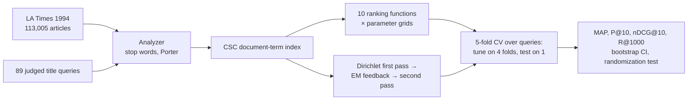
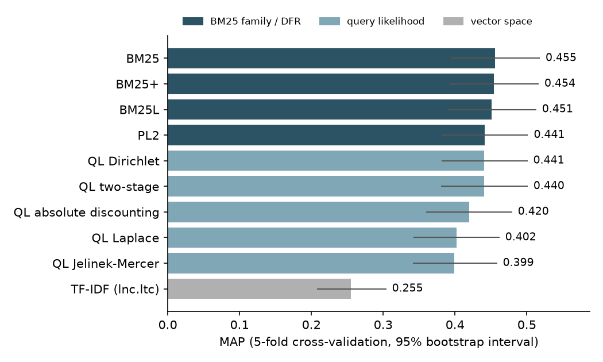
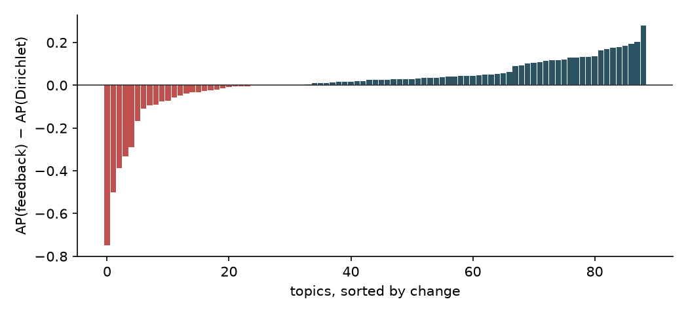

<div align="center">


</div>

# BM25, Divergence from Randomness and Smoothed Language Models on a News Collection

A comparison of ten lexical ranking functions and model-based pseudo-relevance feedback on 110,000 Los Angeles Times articles with 89 judged title queries. Every parameter is tuned by cross-validation over queries, and every difference is tested for significance.

<div align="left">

[](https://www.python.org/downloads/)
[](https://scipy.org)
[](https://github.com/cvangysel/pytrec_eval)
[](data/README.md)
[](LICENSE)

</div>

## Abstract

The models cover four families: cosine TF-IDF; BM25 and two fixes for its long-document bias (BM25L, BM25+); the PL2 divergence-from-randomness model; and query likelihood with five smoothing methods. They are evaluated with 5-fold cross-validation over the queries, so no score comes from queries used to choose its parameters.

- **One leading group.** Tuned BM25 scores best (MAP 0.456). BM25+, BM25L, PL2, Dirichlet and two-stage smoothing are within 0.016 MAP and not significantly different from it. Jelinek-Mercer, Laplace and absolute-discounting smoothing are significantly worse, and cosine TF-IDF is far behind (0.255).
- **Tuning matters as much as the model.** On these long articles BM25 wants little length normalisation (b = 0.3–0.4). The common default b = 0.75 gives 0.429.
- **Feedback raises recall, not reliably MAP.** EM mixture-model feedback lifts recall from 0.905 to 0.939 and helps 58 of 89 queries, but query drift on a few (for example *Moldova referendum* drifting to *Quebec*) leaves the MAP gain non-significant.
- **Stemming helps, stop words do not matter.** Porter stemming adds about 0.035 MAP (p < 0.05). Removing stop words changes nothing in effectiveness but makes the index 37% smaller.

The protocol, all tables, the per-query analysis and the discussion are in the [report](REPORT.md).

## Table of Contents

1. [Key Features](#key-features)
2. [Project Workflow](#project-workflow)
3. [Results at a Glance](#results-at-a-glance)
4. [Repository Structure](#repository-structure)
5. [Installation and Usage](#installation-and-usage)
6. [Dataset](#dataset)
7. [Key Concepts](#key-concepts)
8. [Limitations](#limitations)
9. [References](#references)
10. [License](#license)

## Key Features

- **Sparse inverted index** in SciPy CSC format (one column per term), built in about 20 seconds; all models score a whole query set in well under a second.
- **Ten ranking functions** written from their published formulas: lnc.ltc TF-IDF, BM25, BM25L, BM25+, PL2 (Terrier's formula), and query likelihood with Laplace, Jelinek-Mercer, Dirichlet, absolute-discounting and two-stage smoothing.
- **Model-based feedback** (Zhai & Lafferty, 2001): EM separates a feedback topic model from the collection background, and the expanded query is scored by cross entropy.
- **Leak-free tuning:** parameters are chosen on four folds and applied to the fifth. For comparison, the report also gives the score of the best setting on all queries, which overstates feedback by about 0.02 MAP.
- **Statistics:** bootstrap confidence intervals over queries and paired randomization tests with Holm correction.
- **Preprocessing ablation:** four indexes (stop words kept or removed × stemming on or off), each tuned separately.
- **Tests:** BM25 and PL2 against their formulas, every smoothed model summing to 1, monotone EM likelihood, the four measures against `pytrec_eval`, and cross-validation that never reads the test fold. The tests run in CI on a toy corpus.

## Project Workflow



## Results at a Glance

5-fold cross-validated scores over 89 queries (1,000 documents per query):

| Model | MAP | P@10 | nDCG@10 | R@1000 | vs BM25 |
|---|---|---|---|---|---|
| **BM25** | **0.456** | 0.405 | **0.577** | 0.921 | |
| BM25+ | 0.454 | 0.402 | 0.573 | 0.918 | n.s. |
| Dirichlet + EM feedback | 0.453 | **0.423** | 0.565 | **0.939** | n.s. |
| BM25L | 0.451 | 0.398 | 0.567 | 0.919 | n.s. |
| PL2 | 0.441 | 0.402 | 0.562 | 0.917 | n.s. |
| QL Dirichlet | 0.441 | 0.396 | 0.561 | 0.905 | n.s. |
| QL two-stage | 0.440 | 0.399 | 0.560 | 0.921 | n.s. |
| QL absolute discounting | 0.420 | 0.392 | 0.543 | 0.910 | worse (p = 0.02) |
| QL Laplace | 0.402 | 0.391 | 0.532 | 0.870 | worse (p = 0.006) |
| QL Jelinek-Mercer | 0.399 | 0.369 | 0.504 | 0.907 | worse (p < 0.001) |
| TF-IDF (lnc.ltc) | 0.255 | 0.245 | 0.331 | 0.886 | worse (p < 0.001) |

p: paired randomization test on per-query AP, Holm-adjusted; n.s. = not significant at 0.05.

<p align="center">
  
  
</p>

## Repository Structure

```text
bm25-vs-language-models/
│
├── lexret/
│   ├── corpus.py        # readers for the articles, topics and judgments
│   ├── text.py          # tokenisation, stop words, cached Porter stemming
│   ├── index.py         # sparse document-term index with collection statistics
│   ├── models.py        # the ten ranking functions and their parameter grids
│   ├── feedback.py      # EM mixture-model pseudo-relevance feedback
│   ├── evaluate.py      # measures, cross-validation, randomization test, Holm
│   └── experiment.py    # shared experiment helpers
│
├── scripts/             # build_index, run_models, run_feedback, run_preprocessing
├── results/             # tables (.md), raw numbers (.json), figures/
├── tests/               # 17 unit tests on a toy corpus
├── REPORT.md            # detailed report
├── run_all.sh           # rebuilds the indexes and every result
└── requirements.txt
```

## Installation and Usage

```bash
git clone https://github.com/faezehmzf/bm25-vs-language-models.git
cd bm25-vs-language-models
python3.11 -m venv .venv && .venv/bin/pip install -r requirements.txt
.venv/bin/python -m pytest -q                 # no data needed
# put the collection in data/ (see data/README.md), then:
PY=.venv/bin/python ./run_all.sh             # about 15 minutes on a laptop
```

Using the library on a built index:

```python
from lexret.experiment import load_setup
from lexret.models import bm25
from lexret.evaluate import top_k

s = load_setup("stop-porter")
query = s.queries["114"]                     # "civil war in afghanistan", as {term_id: weight}
rows, scores = bm25(s.index, query, k1=1.2, b=0.3)
top_k(rows, scores, s.index.docnos, k=5)     # five best article ids
```

## Dataset

| Data | Size | Source |
|---|---|---|
| Los Angeles Times 1994 articles | 113,005 articles (110,282 non-empty) | CLEF English ad-hoc collection, distributed by ELRA |
| Topics 41–140, title field | 100 queries, 89 with relevant articles | CLEF |
| Relevance judgments | 1,677 relevant articles, 1–107 per query | CLEF |

The collection is licensed and is not included. [`data/README.md`](data/README.md) lists the expected files and formats.

## Key Concepts

- Term-frequency saturation, document-length normalisation and idf in BM25; why cosine normalisation fails on long documents.
- Divergence from randomness: term informativeness measured against a Poisson model.
- Query likelihood and smoothing as idf and length normalisation in disguise.
- Pseudo-relevance feedback with an EM mixture model, and query drift.
- Evaluation methodology: query-level cross-validation, bootstrap intervals, randomization tests, multiple-comparison correction.

## Limitations

- 89 short title queries on one newspaper year. Differences of 0.01–0.02 MAP between the leading models are within the confidence intervals.
- Pooled binary judgments; unjudged documents count as non-relevant.
- Classical lexical models only; no neural or learned sparse retrieval.

See the [report](REPORT.md#8-limitations) for details.

## References

- S. Robertson & H. Zaragoza (2009). The Probabilistic Relevance Framework: BM25 and Beyond. *Foundations and Trends in IR*.
- Y. Lv & C. Zhai (2011). When Documents Are Very Long, BM25 Fails! *SIGIR*.
- G. Amati & C. J. van Rijsbergen (2002). Probabilistic Models of Information Retrieval Based on Measuring the Divergence from Randomness. *ACM TOIS*.
- C. Zhai & J. Lafferty (2004). A Study of Smoothing Methods for Language Models Applied to Information Retrieval. *ACM TOIS*.
- C. Zhai & J. Lafferty (2001). Model-based Feedback in the Language Modeling Approach to Information Retrieval. *CIKM*.
- M. D. Smucker, J. Allan & B. Carterette (2007). A Comparison of Statistical Significance Tests for Information Retrieval Evaluation. *CIKM*.

## License

The code is released under the [MIT licence](LICENSE). The collection is not included.

<div align="center">

</div>
