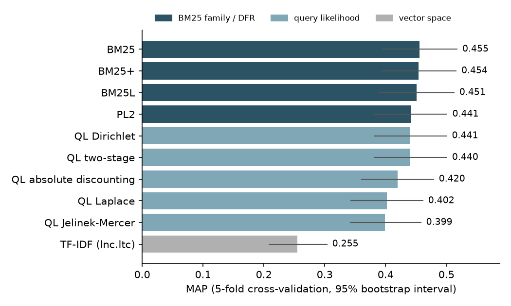
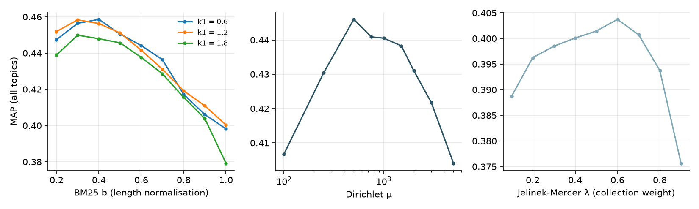
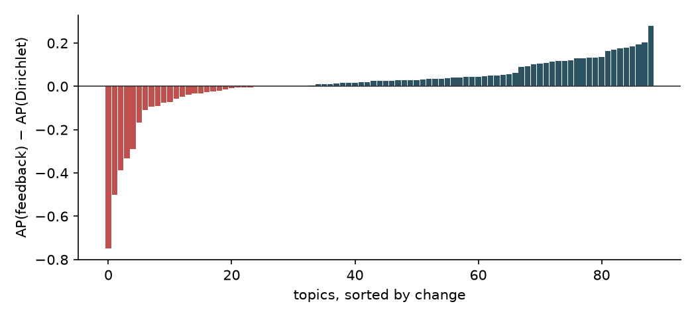

# Report: Lexical Retrieval Models on the LA Times Collection

This report describes the collection, the preprocessing, the models, the evaluation protocol and the results. Every number comes from the files in [`results/`](results/), written by the scripts in [`scripts/`](scripts/) (`run_all.sh` runs them in order).

## Contents

1. [Questions](#1-questions)
2. [Collection and preprocessing](#2-collection-and-preprocessing)
3. [Models](#3-models)
4. [Evaluation protocol](#4-evaluation-protocol)
5. [Results: ranking models](#5-results-ranking-models)
6. [Results: pseudo-relevance feedback](#6-results-pseudo-relevance-feedback)
7. [Results: stop words and stemming](#7-results-stop-words-and-stemming)
8. [Limitations](#8-limitations)
9. [Reproducibility](#9-reproducibility)
10. [References](#10-references)

---

## 1. Questions

- How do the main families of lexical ranking functions compare on news search with short queries: vector space, BM25 and its variants, divergence from randomness, and smoothed query likelihood?
- How much of each model's score depends on tuning, and how sensitive are the parameters?
- Does model-based pseudo-relevance feedback improve over a single query-likelihood pass, and on how many queries?
- What do stop-word removal and stemming contribute?

Tuning parameters and reporting results on the same queries overstates every model, and overstates models with many parameters most. Here all parameters are chosen by cross-validation over queries, so every reported score is measured on queries that were not used to choose it.

## 2. Collection and preprocessing

| | |
|---|---|
| Documents | 113,005 Los Angeles Times articles from 1994 (CLEF English ad-hoc collection) |
| Indexed fields | headline and text |
| Indexed documents | 110,282 (2,723 articles have no headline or text) |
| Queries | titles of topics 41–140, 2–6 words (e.g. *pesticides in baby food*, *el niño and the weather*) |
| Judged queries | 89 topics with at least one relevant article; 1,677 relevant articles, 1–107 per topic (median 10) |
| Judgments | binary |

Analysis, applied identically to documents and queries: lower-casing, tokens of letters and digits in any script (so *niño* is one token) with internal apostrophes, removal of a trailing possessive *'s*, removal of a 170-word stop list, and Porter stemming. After analysis the index has 181,082 terms and 39.8 million tokens (361 per document on average). The index is a sparse document–term count matrix in SciPy CSC format, so a term's postings are a column slice.

## 3. Models

Only documents that contain at least one query term are scored, as in standard search engines. Query likelihood scores include the smoothed probability of query terms that are absent from the document.

| Family | Model | Parameters (grid) |
|---|---|---|
| Vector space | TF-IDF, SMART lnc.ltc (cosine) | none |
| Probabilistic | BM25, idf = ln(1 + (N − df + 0.5)/(df + 0.5)) | k1 ∈ {0.6 … 2.1}, b ∈ {0.2 … 1.0} |
| | BM25L (Lv & Zhai, 2011), δ = 0.5 | same grid |
| | BM25+ (Lv & Zhai, 2011), δ = 1 | same grid |
| Divergence from randomness | PL2 with normalisation 2 (Terrier's formula) | c ∈ {0.5 … 15} |
| Query likelihood | Laplace / Lidstone | δ ∈ {0.001 … 1} |
| | Jelinek-Mercer, λ = collection weight | λ ∈ {0.1 … 0.9} |
| | Dirichlet | μ ∈ {100 … 5000} |
| | absolute discounting | δ ∈ {0.1 … 0.9} |
| | two-stage (Dirichlet, then Jelinek-Mercer) | μ ∈ {250 … 2000}, λ ∈ {0.1 … 0.7} |
| Feedback | Dirichlet + EM mixture-model feedback (Zhai & Lafferty, 2001) | μ, feedback documents, expansion terms, α, background weight |

The feedback model treats the top-k documents of a Dirichlet run as relevant and assumes each word occurrence in them comes from a topic model θ_F or from the collection model, mixed with a fixed background weight. EM estimates θ_F, the top terms of θ_F are interpolated with the original query (weight α), and documents are re-ranked by cross entropy with the Dirichlet document models. The expanded query is a new object for each run, so different feedback settings cannot affect each other.

## 4. Evaluation protocol

- **Measures:** MAP over the top 1,000 documents, P@10, nDCG@10 and recall at 1,000, computed as in trec_eval for binary judgments. A unit test checks all four against `pytrec_eval`.
- **Tuning:** the 89 judged topics are split into 5 fixed folds. For each test fold, the parameter setting with the best MAP on the other four folds is applied to it. Tables report the mean over all held-out topics.
- **Uncertainty:** 95% bootstrap intervals over topics for MAP.
- **Significance:** two-sided paired randomization test on per-topic AP (100,000 sign flips) against BM25, with Holm correction across the nine comparisons.
- **Ties:** documents with equal scores are ordered by index position, so every run is deterministic.

## 5. Results: ranking models

| Model | MAP | MAP 95% CI | P@10 | nDCG@10 | R@1000 | p vs BM25 (Holm) | Topics better / worse than BM25 |
|---|---|---|---|---|---|---|---|
| **BM25** | **0.4555** | [0.394, 0.518] | **0.4045** | **0.5766** | 0.9208 | | |
| BM25+ | 0.4540 | [0.393, 0.517] | 0.4022 | 0.5730 | 0.9184 | 0.746 | 48 / 30 |
| BM25L | 0.4509 | [0.389, 0.513] | 0.3978 | 0.5668 | 0.9188 | 0.561 | 43 / 37 |
| PL2 | 0.4410 | [0.381, 0.502] | 0.4022 | 0.5619 | 0.9166 | 0.399 | 40 / 43 |
| QL Dirichlet | 0.4406 | [0.381, 0.501] | 0.3955 | 0.5610 | 0.9047 | 0.303 | 35 / 46 |
| QL two-stage | 0.4403 | [0.380, 0.501] | 0.3989 | 0.5603 | **0.9205** | 0.383 | 35 / 47 |
| QL absolute discounting | 0.4196 | [0.360, 0.480] | 0.3921 | 0.5432 | 0.9097 | 0.020 | 27 / 57 |
| QL Laplace | 0.4019 | [0.342, 0.462] | 0.3910 | 0.5324 | 0.8695 | 0.006 | 28 / 56 |
| QL Jelinek-Mercer | 0.3992 | [0.341, 0.459] | 0.3685 | 0.5039 | 0.9071 | < 0.001 | 23 / 62 |
| TF-IDF (lnc.ltc) | 0.2552 | [0.208, 0.304] | 0.2449 | 0.3309 | 0.8858 | < 0.001 | 8 / 80 |



**Three groups.** BM25, its two variants, PL2, Dirichlet and two-stage smoothing form one group: none differs significantly from BM25, and their confidence intervals overlap almost completely. Absolute discounting, Laplace and Jelinek-Mercer smoothing are significantly worse. Cosine-normalised TF-IDF is far behind (0.255): on these long articles (361 tokens on average) cosine normalisation over-penalises long documents, which is the problem pivoted normalisation and BM25's b parameter were designed to fix.

**What separates the smoothing methods.** Dirichlet smoothing adapts to document length (short documents get more smoothing), while Jelinek-Mercer applies the same weight to every document. With short title queries, where almost every query term matters, this length-dependent smoothing is what helps: Dirichlet beats Jelinek-Mercer on 64 of 89 topics and loses on 20. The two-stage model, which adds a Jelinek-Mercer stage on top of Dirichlet to model query noise, gives no gain on queries this short.

**Tuning matters as much as the model.** The untuned defaults score clearly lower: BM25 with k1 = 1.2, b = 0.75 reaches MAP 0.4285, and Dirichlet with μ = 2000 reaches 0.4310 (see `results/models.md`). Cross-validation consistently picked a small length normalisation for BM25 (b = 0.3–0.4) and μ = 500–750 for Dirichlet.



The sensitivity curves (all topics, so exploratory) show why. For BM25 with k1 = 1.2, MAP peaks at b = 0.3 (0.458) and falls steadily to 0.400 at b = 1.0. For Dirichlet it peaks at μ = 500 (0.446), drops quickly for smaller μ (0.407 at μ = 100) and slowly for larger μ (0.431 at 2,000, 0.404 at 5,000). Settings chosen on four folds were stable across folds, and the held-out MAP is at most 0.010 below the best single setting on all topics (0.003 for BM25), so tuning on these grids does not overfit the topics.

## 6. Results: pseudo-relevance feedback

The feedback grid has 144 settings: μ ∈ {500, 1000, 2000}, 5/10/20 feedback documents, 20/50 expansion terms, α ∈ {0.2, 0.4, 0.6, 0.8} and background weight 0.5 or 0.8. It is tuned with the same five folds.

| Run | MAP | MAP 95% CI | P@10 | nDCG@10 | R@1000 |
|---|---|---|---|---|---|
| QL Dirichlet | 0.4406 | [0.381, 0.501] | 0.3955 | 0.5610 | 0.9047 |
| BM25 | 0.4555 | [0.394, 0.518] | 0.4045 | 0.5766 | 0.9208 |
| Dirichlet + EM feedback | 0.4525 | [0.392, 0.513] | **0.4225** | 0.5649 | **0.9390** |

- **Feedback helps most topics, but not significantly.** It raises MAP over Dirichlet by 0.012 and is better on 58 of 89 topics and worse on 26, but the paired test gives p = 0.44, because the losses are large: the biggest gain is +0.28 AP and the biggest loss −0.75.
- **The gain is in recall and the top ten.** Recall at 1,000 rises from 0.905 to 0.939 and P@10 from 0.396 to 0.423, the best values of any run. Feedback brings in documents that use other words for the topic.
- **Every fold chose a conservative setting:** μ = 500, only 5 feedback documents, a high background weight (0.8), and α between 0.2 and 0.6.
- **Tuning on the test queries would overstate the gain.** The best single setting on all 89 topics reaches MAP 0.475, against 0.452 when the setting is chosen on other folds. With 144 settings, picking the best one on the evaluation queries alone adds about 0.02 MAP.



The expansion terms show both sides of feedback (Porter stems, fold-0 setting):

| Topic | Title | AP Dirichlet → feedback | Top added terms |
|---|---|---|---|
| 114 | civil war in afghanistan | 0.252 → 0.531 | kabul, hekmatyar, rabbani, dostum, soviet, fight |
| 85 | turquoise program in rwanda | 0.146 → 0.348 | french, food, aid, hutu, rebel, troop |
| 103 | conflict of interests in italy | 0.360 → 0.554 | berlusconi, govern, polit, italian, minist, bossi, corrupt |
| 62 | northern japan earthquake | 1.000 → 0.500 | quak, magnitud, structur, engin, wave, aftershock |
| 97 | referendum on the independence of moldova | 1.000 → 0.250 | quebec, parti, canada, separatist, ukrain |

When the first pass finds good documents, feedback adds the names of the people and places involved (*Kabul, Hekmatyar, Rabbani, Dostum*; *Berlusconi, Bossi*), which the title never mentions. Topics 97 and 62 have a single relevant article each, which the first pass ranks first. The other feedback documents are about something else and pull the query away: the Moldova referendum drifts to Quebec's independence referendum, and the Japan earthquake query drifts to general earthquake engineering. This is the classic query-drift failure of pseudo-relevance feedback, and it explains why the background weight is set high and the number of feedback documents low.

## 7. Results: stop words and stemming

Each variant has its own index and its own cross-validated parameters.

| Model | Analyzer | Vocabulary | Tokens | MAP | P@10 | R@1000 | p vs stop + Porter |
|---|---|---|---|---|---|---|---|
| BM25 | stop words removed, Porter | 181,082 | 39.8M | 0.4555 | 0.4045 | 0.9208 | |
| BM25 | stop words removed, no stemming | 234,370 | 39.8M | 0.4164 | 0.3697 | 0.8878 | 0.029 |
| BM25 | stop words kept, Porter | 181,148 | 62.9M | 0.4565 | 0.4022 | 0.9219 | 0.543 |
| BM25 | stop words kept, no stemming | 234,526 | 62.9M | 0.4175 | 0.3730 | 0.8876 | 0.031 |
| QL Dirichlet | stop words removed, Porter | 181,082 | 39.8M | 0.4406 | 0.3955 | 0.9047 | |
| QL Dirichlet | stop words removed, no stemming | 234,370 | 39.8M | 0.4072 | 0.3629 | 0.8835 | 0.049 |
| QL Dirichlet | stop words kept, Porter | 181,148 | 62.9M | 0.4387 | 0.3989 | 0.9087 | 0.942 |
| QL Dirichlet | stop words kept, no stemming | 234,526 | 62.9M | 0.3998 | 0.3629 | 0.8854 | 0.023 |

- **Stemming helps.** Porter stemming adds 0.034–0.039 MAP and about 0.03 recall for both models (p < 0.05). It merges forms such as *withdrawal / withdraw*, *devaluation / devalue* or *exports / export*, which title queries and articles often use differently. It also has quirks: *viruses* and *virus* become different stems (*virus*, *viru*).
- **Stop-word removal does not change effectiveness** (p = 0.54 and 0.94). Stop words in the queries carry almost no weight, because their idf (BM25) or their collection probability (query likelihood) neutralises them. Removing them still shrinks the index by 37% (62.9M to 39.8M tokens).
- Without stop-word removal the tuned Dirichlet μ roughly doubles (1,000–2,000 instead of 500), because documents are about 1.6 times longer.

## 8. Limitations

- **One collection, short queries.** 89 judged title queries on one year of one newspaper. Differences of 0.01–0.02 MAP between the top models are well within the confidence intervals, so the ranking inside the first group is not meaningful.
- **Binary judgments from pooled runs.** Documents never retrieved by the original pooled systems are unjudged and counted as non-relevant, which can disadvantage models that retrieve very different documents.
- **Fixed grids.** Parameters are searched on grids; finer or wider grids could change the chosen settings slightly.
- **Lexical models only.** No neural or learned sparse model is included; the point is a careful comparison of classical ranking functions under one protocol.
- **Pure Python and SciPy.** Fast enough for this collection (a full run of 89 queries takes about 0.1–0.3 s for most models), but not an engine for large collections.

## 9. Reproducibility

```bash
python3.11 -m venv .venv && .venv/bin/pip install -r requirements.txt
# put LA.xml, topics.xml, qrels.txt and stopwords.txt in data/ (see data/README.md)
PY=.venv/bin/python ./run_all.sh
```

| Script | Output | Time on a laptop |
|---|---|---|
| `build_index.py --all` | four indexes in `data/index/`, `results/index_stats.json` | about 2 minutes |
| `run_models.py` | `models.md`, `models.json`, `per_setting.json`, `per_topic_cv.json`, two figures | about 30 seconds |
| `run_feedback.py` | `feedback.md`, `feedback.json`, per-topic figure | about 12 minutes |
| `run_preprocessing.py` | `preprocessing.md`, `preprocessing.json` | about 1 minute |

The 17 unit tests use a toy corpus and need no data: BM25 and PL2 against their formulas, every smoothed document model summing to 1 over the vocabulary, the EM log-likelihood never decreasing, the four measures against `pytrec_eval`, cross-validation never reading the test fold, and the randomization test and Holm correction.

## 10. References

- S. Robertson & H. Zaragoza (2009). The Probabilistic Relevance Framework: BM25 and Beyond. *Foundations and Trends in IR* 3(4).
- Y. Lv & C. Zhai (2011). When Documents Are Very Long, BM25 Fails! *SIGIR*; and Lower-Bounding Term Frequency Normalization. *CIKM*.
- G. Amati & C. J. van Rijsbergen (2002). Probabilistic Models of Information Retrieval Based on Measuring the Divergence from Randomness. *ACM TOIS* 20(4).
- C. Zhai & J. Lafferty (2004). A Study of Smoothing Methods for Language Models Applied to Information Retrieval. *ACM TOIS* 22(2).
- C. Zhai & J. Lafferty (2001). Model-based Feedback in the Language Modeling Approach to Information Retrieval. *CIKM*.
- C. Zhai & J. Lafferty (2002). Two-Stage Language Models for Information Retrieval. *SIGIR*.
- A. Singhal, C. Buckley & M. Mitra (1996). Pivoted Document Length Normalization. *SIGIR*.
- M. D. Smucker, J. Allan & B. Carterette (2007). A Comparison of Statistical Significance Tests for Information Retrieval Evaluation. *CIKM*.
- C. Peters et al. (eds.) (2004). *Comparative Evaluation of Multilingual Information Access Systems: CLEF 2003*. LNCS 3237.
